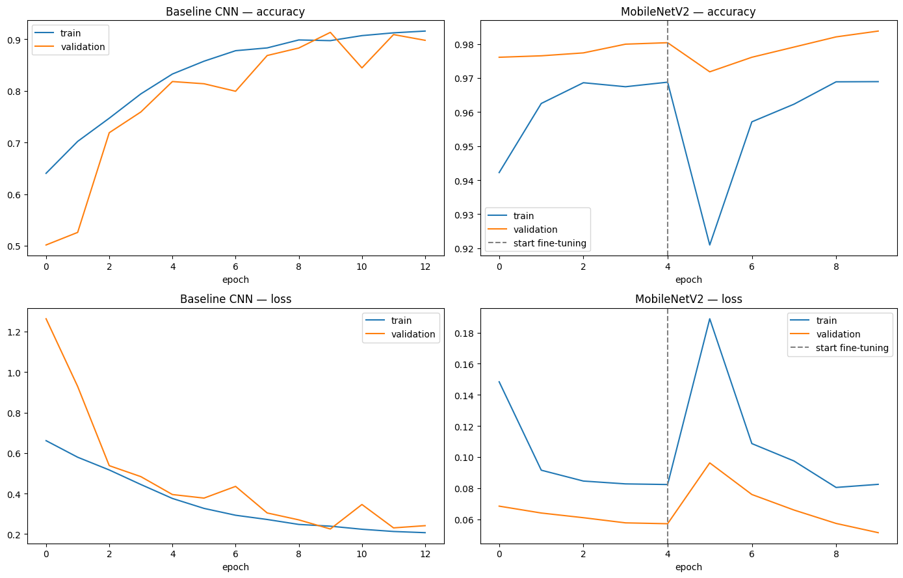
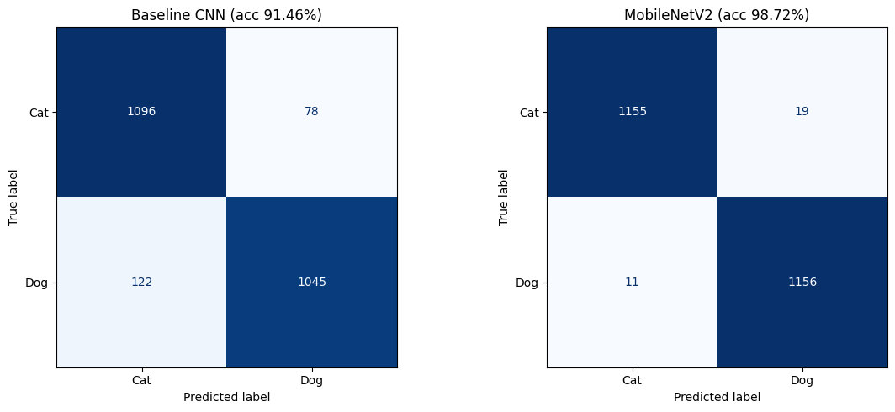

# Cats vs Dogs Vision

University computer-vision project: a cats vs dogs image classifier built with **TensorFlow/Keras**, served by a **Flask** API and used from three clients.

```
                ┌──────────────────────────┐
                │ Keras model (.keras)      │  trained in Google Colab
                └────────────┬─────────────┘
                ┌────────────▼─────────────┐      ┌──────────────────────┐
                │ Flask REST API (JSON)     │─────▶│ MongoDB + GridFS      │
                └──┬──────────┬──────────┬─┘      │ images + metadata     │
                   │          │          │        └──────────────────────┘
          Mobile (Expo)   Web (React)   Desktop (PySide6)
          camera/gallery  files/webcam  webcam/files
```

## Structure

| Folder | Description | Status |
|---|---|---|
| `training/` | Colab notebook: baseline CNN vs MobileNetV2 transfer learning | ✅ |
| `backend/` | Flask API, base64 + metadata in, prediction out, images stored in GridFS | ✅ |
| `web/` | React (Vite) client: file upload + live webcam | ✅ |
| `desktop/` | Python PySide6 client: webcam (live) + files | ✅ |
| `mobile/` | React Native (Expo) client: camera + gallery | ⏳ |

## API contract

`POST /api/predict`
```json
{
  "image": "<base64 string>",
  "metadata": {
    "client": "mobile | web | desktop",
    "source": "camera | gallery | file | webcam",
    "filename": "photo.jpg",
    "mimeType": "image/jpeg",
    "width": 1080,
    "height": 1920,
    "capturedAt": "2026-10-09T15:30:00Z"
  },
  "store": true
}
```
Response:
```json
{ "id": "...", "label": "dog", "confidence": 0.97, "probabilities": { "cat": 0.03, "dog": 0.97 } }
```
`label` is `"uncertain"` when confidence is below the threshold. Live-mode frames are sent with `"store": false` so they are not saved.

## 1. Training

1. Open `training/cats_vs_dogs_training.ipynb` in [Google Colab](https://colab.research.google.com/) (File → Upload notebook).
2. `Runtime → Change runtime type → T4 GPU`.
3. `Runtime → Run all`. It takes about 20–30 min and downloads `cats_dogs_export.zip` at the end.
4. Unzip it into `training/export/`.

### Results (held-out test set, 2,341 images)

| Model | Test accuracy | Training time (T4) |
|---|---|---|
| Baseline CNN (from scratch) | 91.46% | 11.4 min |
| **MobileNetV2 (transfer learning + fine-tuning)** | **98.72%** | 6.2 min |




## 2. Backend (Flask + MongoDB)

Requires MongoDB running locally (`mongodb://localhost:27017`).

```bash
cd backend
python -m venv .venv
.venv\Scripts\pip install -r requirements.txt
.venv\Scripts\python app.py
```

The API listens on `http://0.0.0.0:5000`. Other devices on the same Wi-Fi (the phone) reach it at `http://<your-PC-IP>:5000`.

| Method | Endpoint | Description |
|---|---|---|
| GET | `/api/health` | Server, database and model status |
| POST | `/api/predict` | Classify a base64 image (stores it in GridFS unless `"store": false`) |
| GET | `/api/history?limit=20&client=web` | Latest stored predictions |
| GET | `/api/predictions/<id>` | One prediction |
| DELETE | `/api/predictions/<id>` | Delete a prediction and its image |
| GET | `/api/images/<imageId>` | Original image bytes from GridFS |

MongoDB layout (database `cats_dogs_vision`):
- `images.files` / `images.chunks`: GridFS bucket with the original image bytes plus the client metadata.
- `predictions`: one document per stored prediction (`metadata`, `image` info such as size and sha256, `prediction`, `createdAt`, `imageFileId`).

## 3. Web client (React + Vite)

```bash
cd web
npm install
npm run dev
```

Open http://localhost:5173 (the backend must be running). Vite forwards `/api/*` to `http://localhost:5000`.

- **Upload**: drag and drop or pick one or more images. Each one is converted to base64 and sent with its metadata (filename, type, size, dimensions, last modified).
- **Webcam**: *live prediction* classifies a frame about 3 times per second without saving it (`store: false`). *Snapshot & save* classifies one frame and stores it in MongoDB.
- **History**: gallery of stored predictions from every client, with filters by client and label, a details view (metadata + GridFS info) and delete.

## 4. Desktop client (Python + PySide6 + OpenCV)

```powershell
cd desktop
python -m venv .venv
.venv\Scripts\pip install -r requirements.txt
.venv\Scripts\python main.py
```

Optional: `.venv\Scripts\python main.py http://<server-ip>:5000` to use a backend on another machine (default `http://127.0.0.1:5000`).

- **Upload**: "Choose images..." or drag and drop files into the window.
- **Webcam**: pick the camera, *Start live prediction* (result drawn on the video, frames not stored) or *Snapshot and save*.
- **History**: same data as the web client; double-click an image for metadata and GridFS details, or to delete it.

All network calls run in background threads, so the window never freezes while waiting for the server.

> Use `127.0.0.1` instead of `localhost` on Windows: `localhost` tries IPv6 first and adds about 2 s to every request.

### Backend tests

Tests use the real model and a throwaway `cats_dogs_vision_test` database:
```bash
cd backend
.venv\Scripts\python -m pytest -q
```
